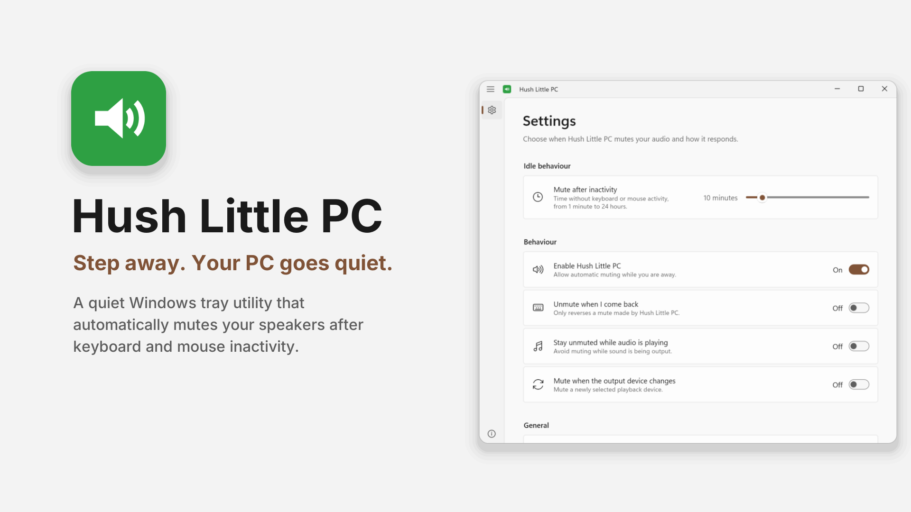
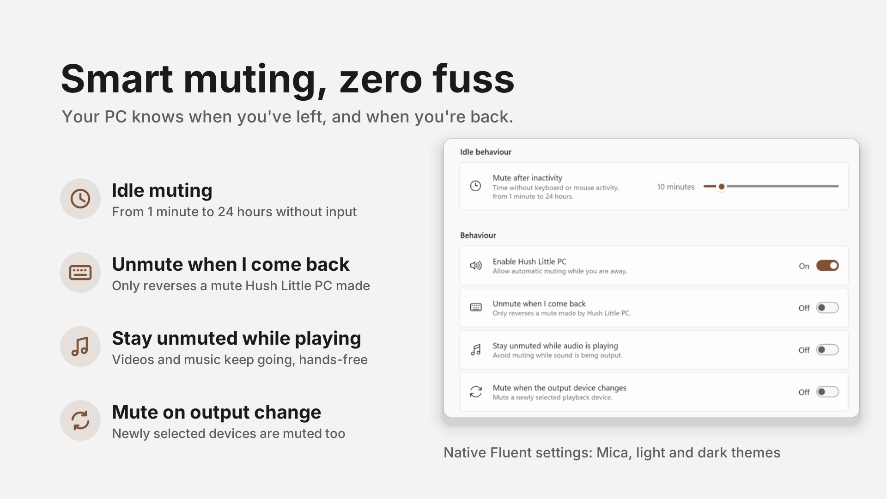
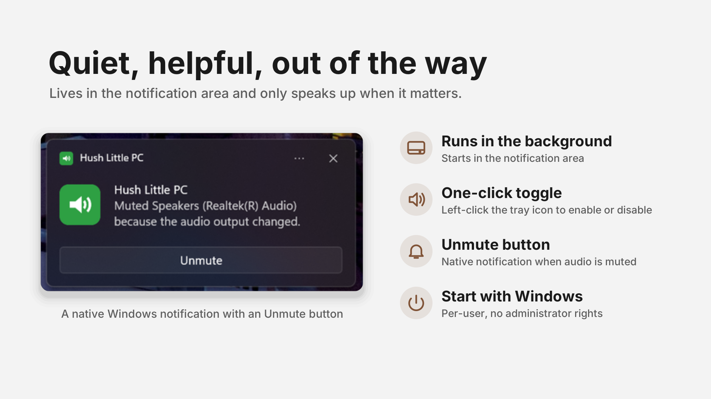

# Hush Little PC

A quiet Windows tray utility that automatically mutes your default playback device after a configurable period of keyboard and mouse inactivity.

Step away from your PC and Hush Little PC quietly mutes the sound. It runs in the background from the notification area: click the tray icon to turn it on or off.

## Features

- **Idle muting:** mutes your default playback device after 1 minute to 24 hours without keyboard or mouse input.
- **Runs in the background:** starts in the notification area. The settings window opens on the first run, and afterwards only when you open it (or turn on **Open settings on startup**).
- **One-click toggle:** left-click the tray icon to enable or disable. The icon changes to show the current state.
- **Native tray menu:** right-click for Enabled, Mute now, Settings, and Exit.
- **Unmute when I come back (optional):** only unmutes if Hush Little PC muted the device itself.
- **Stay unmuted while audio is playing (optional):** avoids muting while sound is being output.
- **Mute on output change (optional):** mutes the new default device when Windows switches playback devices.
- **Notification with an Unmute button (optional):** a native Windows notification when the app mutes an unmuted device.
- **Start with Windows (optional):** per-user startup registration; no administrator rights required.
- **Native Fluent settings:** WinUI 3 settings cards, Mica material on Windows 11, light and dark themes, and adaptive navigation.

## Requirements

- Windows 10 version 2004 (build 19041) or later, or Windows 11.
- x64 release builds.

The standalone executable and Microsoft Store distributions include the required .NET and Windows App SDK runtimes. You do not need to install either runtime separately.

## Install

- **Microsoft Store:** install [Hush Little PC from the Microsoft Store](https://apps.microsoft.com/store/detail/9PDNXTB6MG9L?cid=DevShareMCLPCS). Updates are delivered by the Store.
- **Standalone executable:** download `HushLittlePC_<version>_x64.exe` from the [Releases](../../releases) page.

## Usage

Hush Little PC runs in the notification area. The settings window opens on the first run; after that, open it from the tray menu (or turn on **Open settings on startup**). Starting the app again while it's already running does nothing, because only one copy runs at a time.

Closing the settings window keeps Hush Little PC running in the notification area. To quit, choose **Exit** from the tray menu.

| Action | Result |
| --- | --- |
| Left-click the tray icon | Enable or disable idle muting |
| Right-click the tray icon | Open the menu (Enabled, Mute now, Settings, Exit) |

### Settings

| Setting | Default | Description |
| --- | --- | --- |
| Mute after inactivity | 10 minutes | Idle time before muting, from 1 minute to 24 hours. The slider steps are finer at short timeouts. |
| Enable Hush Little PC | On | Turns automatic muting on or off. Same as left-clicking the tray icon. |
| Unmute when I come back | Off | Unmutes on activity, only if Hush Little PC muted the device. |
| Stay unmuted while audio is playing | Off | Skips muting while sound is being output. |
| Mute when the output device changes | Off | Mutes the new default playback device when Windows switches outputs. |
| Show mute notifications | On | Shows a Windows notification with an Unmute action. |
| Run at startup | Off | Starts Hush Little PC when you sign in. Standalone build: uses the per-user Run key. Store build: uses the package StartupTask (manage it under **Settings > Apps > Startup**). |
| Open settings on startup | Off | Opens the settings window each time the app starts. When off, the app starts in the notification area; the window still opens on the first run. |

Settings are saved automatically as you change them, to `settings.json` in the app's data folder:

- **All installations:** `%LocalAppData%\HushLittlePC`. The standalone executable and Microsoft Store version use the same location. For the Store version, Windows redirects this path to the package's private storage.

When upgrading from an older standalone release, files in the previous `Data` folder beside the executable are copied into `%LocalAppData%\HushLittlePC` if they aren't already there. Legacy settings in `%AppData%\HushLittlePC\settings.json` are also copied when needed. Original files are left in place.

## Limitations

- "Mute when the output device changes" reacts to Windows changing the *default device*. Plugging headphones into a wired 3.5 mm jack usually does not change the default device, so it will not trigger.
- Only the default playback device is muted, not every audio device.
- Idle detection is system-wide input only. Playing media without touching the keyboard or mouse counts as idle unless "Stay unmuted while audio is playing" is enabled.

## Troubleshooting

Hush Little PC writes a single best-effort `app.log` to its data folder (see [Settings](#settings)). It includes startup, runtime, audio, and settings diagnostics. Logging never prevents the app from running.

The log is capped at 512 KiB. When it reaches the cap it is renamed to `app.old.log` (replacing the previous one) and a fresh log starts, so the entries just before the rollover are kept.

The About page shows the app/runtime version and can copy basic environment diagnostics to the clipboard, which is handy when reporting a problem.

## Uninstall

1. Turn off **Run at startup** in Settings.
2. Right-click the tray icon and choose **Exit**.
3. Delete the standalone executable. To remove its settings and logs as well, delete `%LocalAppData%\HushLittlePC`. If you upgraded from an older version, you can also delete the legacy `%AppData%\HushLittlePC` folder after confirming your settings have migrated.

For the Store version, uninstall it from **Settings > Apps > Installed apps**.

## Contributing

Want to build from source or contribute? See the [development guide](docs/development.md).

## License

This project is licensed under the [MIT License](LICENSE).
