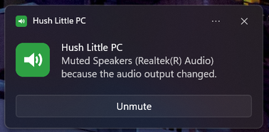

# HushLittlePC

A tiny Windows tray app that automatically mutes your speakers after a configurable period of keyboard and mouse inactivity.

Step away from your PC and HushLittlePC quietly mutes the sound. Click the tray icon to turn it on or off.

<a href="https://get.microsoft.com/installer/download/9pdnxtb6mg9l?referrer=appbadge" target="_self" >
	
</a>




## Features

- **Idle muting:** mutes your default playback device after 1 to 1440 minutes (24 hours) without keyboard or mouse input.
- **One-click toggle:** left-click the tray icon to enable or disable. The icon changes colour to show the current state.
- **Native tray menu:** right-click for Enabled, Mute now, Settings and Exit. It uses the standard Windows menu, so it matches the Windows 11 look and follows light/dark mode.
- **Unmute when I come back (optional):** only unmutes if HushLittlePC did the muting, so a mute you set yourself is never undone.
- **Stay unmuted while audio is playing (optional):** handy for watching videos or listening to music without touching the PC.
- **Mute on output change (optional):** mutes the new device when Windows switches the default playback device, for example when Bluetooth headphones connect or you switch to speakers.
- **Notification with an Unmute button (optional):** a native Windows notification when HushLittlePC changes an unmuted device to muted, so you can undo it with one click. Already-muted devices do not trigger a notification.
- **Start with Windows (optional):** per-user startup entry, no admin rights needed.
- **Follows your output device:** switching to headphones, HDMI or Bluetooth just works.

## Requirements

- Windows 10 or 11
- [.NET 8 Desktop Runtime](https://dotnet.microsoft.com/download/dotnet/8.0) for the portable exe (not needed for the Microsoft Store version, which bundles its own runtime, or if you publish self-contained, see below)

## Install

- **Microsoft Store:** install from [HushLittlePC on the Microsoft Store](https://apps.microsoft.com/store/detail/9PDNXTB6MG9L?cid=DevShareMCLPCS). Updates are delivered by the Store.
- **Portable:** download `HushLittlePC_<version>_x64-portable.exe` from the [Releases](../../releases) page (needs the .NET 8 Desktop Runtime).

## Build

You need the [.NET 8 SDK](https://dotnet.microsoft.com/download).

```
dotnet publish -c Release -r win-x64 --self-contained false -p:PublishSingleFile=true
```

The exe is created at `bin\Release\net8.0-windows10.0.19041.0\win-x64\publish\HushLittlePC.exe`.

To produce an exe that runs without the .NET runtime installed (larger file), use `--self-contained true` instead.

## Pre-commit checks

Install [pre-commit](https://pre-commit.com/) and enable the hooks:

```
python -m pip install pre-commit
pre-commit install
```

Before each commit, the hooks check whitespace, final newlines, merge-conflict markers and YAML syntax, and the commit message is checked against [Conventional Commits](https://www.conventionalcommits.org/). Changes to C# files or the project file also trigger a Release build and the unit tests. Run all checks manually with `pre-commit run --all-files`.

Run the core unit tests directly with `dotnet test tests/HushLittlePC.Tests.csproj -c Release`. They cover idle-threshold muting, manually muted and app-muted devices, return-from-idle unmuting, skipping active playback, output-change gating, notification eligibility, mute transitions, enabled-state toggling, and settings defaults, limits and serialization. Windows-specific audio hardware, toast delivery, startup registration, tray rendering, and single-instance behavior still require Windows integration testing.

## Usage

| Action | Result |
| --- | --- |
| Left-click the tray icon | Enable or disable idle muting |
| Right-click the tray icon | Open the menu (Enabled, Mute now, Settings, Exit) |

### Settings

| Setting | Description |
| --- | --- |
| Mute after *N* minutes | Idle time before muting. Slider goes up to 2 hours; type up to 24 hours. |
| Enable HushLittlePC | Turns all muting on or off. Same as clicking the tray icon. |
| Unmute when I come back | Unmutes on activity, only if HushLittlePC muted it. |
| Stay unmuted while audio is playing | Skips muting while sound is being output. |
| Mute when the audio output changes | Mutes the new default playback device whenever Windows switches outputs. |
| Show a notification when audio is muted | Windows notification with an Unmute button each time audio is muted. |
| Start HushLittlePC with Windows | Portable exe: adds an entry under `HKCU\Software\Microsoft\Windows\CurrentVersion\Run`. Store version: enables its startup task (manage it under **Settings > Apps > Startup**; if you turn it off there, Windows only lets you turn it back on there). |

Settings are saved with **Save changes**, which is enabled only after an option changes. Closing with unsaved edits asks for confirmation before discarding them.

Settings are saved to `%AppData%\HushLittlePC\settings.json`. If you edit the file by hand, the idle time is kept within 1 to 1440 minutes. For the Store version Windows redirects this folder to the package's private storage, and it is removed when you uninstall.

## How it works

- Idle time comes from the Win32 `GetLastInputInfo` API, checked once per second. Only keyboard and mouse input counts as activity.
- Notifications use the [Windows Community Toolkit notifications library](https://learn.microsoft.com/windows/apps/design/shell/tiles-and-notifications/send-local-toast) (`Microsoft.Toolkit.Uwp.Notifications`).
- Muting uses the Windows Core Audio API (through [NAudio](https://github.com/naudio/NAudio)) on the current default playback device, which is looked up again on every check so output switches are picked up.
- Muting is tracked so the app only unmutes what it muted itself. The decision logic lives in `IdleMutePolicy` and is covered by unit tests.
- Startup uses the per-user `Run` registry key for the portable exe and the manifest's `StartupTask` for the Store (MSIX) package, because packaged apps can't write to the `Run` key.
- Output changes are detected through the Windows Core Audio device notifications (the default playback device changing).
- "Audio is playing" is detected from the device's master peak meter.
- The tray menu is a native Win32 popup menu. Light/dark theming uses undocumented `uxtheme.dll` calls; on versions of Windows that lack them, the menu simply stays light.

## Project layout

| Path | Purpose |
| --- | --- |
| `Program.cs` | Entry point and single-instance check |
| `TrayApp.cs` | Tray icon, idle-check timer, mute orchestration |
| `IdleMutePolicy.cs` | Pure decision logic: when to mute, unmute or notify |
| `MuteTransition.cs` | Mutes a device only if needed and reports its prior state |
| `NativeMenu.cs` | Native Win32 tray menu |
| `Notifier.cs` | Native Windows notifications with an Unmute button |
| `SettingsForm.cs` | Settings window |
| `SettingsModel.cs` | `Settings` type and JSON serialization (no Windows dependencies, so it is unit-tested) |
| `Settings.cs` | Settings file storage and the start-with-Windows logic (registry or MSIX startup task) |
| `Native.cs` | Idle-time, audio-device and output-change helpers |
| `tests/` | MSTest unit tests for the platform-independent logic |
| `packaging/` | MSIX manifest and Store assets |
| `store/`, `docs/`, `resources/` | Store listing art, README images, embedded notification icon |
| `.github/` | CI, release and commit-lint workflows, Dependabot config, MSIX packaging script |

## Contributing

- Pull request titles must follow [Conventional Commits](https://www.conventionalcommits.org/) (for example `fix: ...`, `feat: ...`), because the title becomes the commit message on `main` and drives versioning. CI lints the title on every pull request, and the check is required before merging. The pre-commit hook gives the same feedback locally for individual commits.
- CI builds the app and runs the unit tests on every pull request and push to `main`.
- When CI succeeds on `main`, [semantic-release](https://semantic-release.gitbook.io/) creates the version tag and GitHub release, attaches the portable exe, and submits the MSIX package to the Microsoft Store.
- Store publishing needs these repository settings: variables `MSIX_IDENTITY_NAME`, `MSIX_PUBLISHER` and `MSIX_PUBLISHER_DISPLAY_NAME`, and secrets `TENANT_ID`, `SELLER_ID`, `CLIENT_ID`, `SECRET_VALUE` and `STORE_ID`. The release workflow stops early with a clear message if the variables are missing.
- Enable the [pre-commit checks](#pre-commit-checks) to catch problems before pushing.

## Uninstall

1. Untick **Start HushLittlePC with Windows** in Settings.
2. Right-click the tray icon and choose **Exit**.
3. Delete the exe and, if you like, the `%AppData%\HushLittlePC` and `%LocalAppData%\HushLittlePC` folders (the latter holds the notification icon).

For the Store version, uninstall it from **Settings > Apps > Installed apps** instead; that also removes its settings.

## Limitations

- "Mute when the audio output changes" reacts to Windows changing the *default device* (Bluetooth, USB, HDMI, or picking another output). Plugging headphones into a wired 3.5 mm jack usually doesn't change the default device, so it won't trigger.
- Only the default playback device is muted, not every audio device.
- Idle detection is system-wide input only. Playing media without touching the keyboard or mouse counts as idle unless "Stay unmuted while audio is playing" is on.

## License

This project is licensed under the [MIT License](LICENSE).
