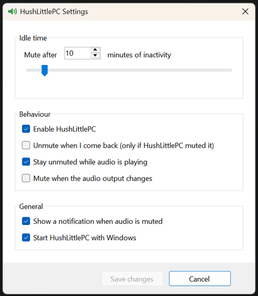

# HushLittlePC

A tiny Windows tray app that automatically mutes your speakers after a configurable period of keyboard and mouse inactivity.

Step away from your PC and HushLittlePC quietly mutes the sound. Click the tray icon to turn it on or off.

<!-- Add a screenshot of the settings window here, e.g.  -->

## Features

- **Idle muting:** mutes your default playback device after 1 to 1440 minutes without keyboard or mouse input.
- **One-click toggle:** left-click the tray icon to enable or disable. The icon changes colour to show the current state.
- **Native tray menu:** right-click for Enabled, Mute now, Settings and Exit. It uses the standard Windows menu, so it matches the Windows 11 look and follows light/dark mode.
- **Unmute when I come back (optional):** only unmutes if HushLittlePC did the muting, so a mute you set yourself is never undone.
- **Stay unmuted while audio is playing (optional):** handy for watching videos or listening to music without touching the PC.
- **Mute on output change (optional):** mutes the new device when Windows switches the default playback device, for example when Bluetooth headphones connect or you switch to speakers.
- **Notification with an Unmute button (optional):** a native Windows notification whenever HushLittlePC mutes, so you can undo it with one click.
- **Start with Windows (optional):** per-user startup entry, no admin rights needed.
- **Follows your output device:** switching to headphones, HDMI or Bluetooth just works.
- **Single instance:** launching it twice won't create a second tray icon.

## Requirements

- Windows 10 or 11
- [.NET 8 Desktop Runtime](https://dotnet.microsoft.com/download/dotnet/8.0) (not needed if you publish self-contained, see below)

## Install

- **Microsoft Store:** link coming once the first submission is live.
- **Portable:** download `HushLittlePC_<version>_x64-portable.exe` from the [Releases](../../releases) page (needs the .NET 8 Desktop Runtime).

## Build

You need the [.NET 8 SDK](https://dotnet.microsoft.com/download).

```
dotnet publish -c Release -r win-x64 --self-contained false -p:PublishSingleFile=true
```

The exe is created at `bin\Release\net8.0-windows10.0.19041.0\win-x64\publish\HushLittlePC.exe`.

To produce an exe that runs without the .NET runtime installed (larger file), use `--self-contained true` instead.

## Usage

| Action | Result |
| --- | --- |
| Left-click the tray icon | Enable or disable idle muting |
| Right-click the tray icon | Open the menu (Enabled, Mute now, Settings, Exit) |

### Settings

| Setting | Description |
| --- | --- |
| Mute after *N* minutes | Idle time before muting. Slider goes up to 2 hours; type up to 24 hours. |
| Enable HushLittlePC | Turns all muting on or off. Same as clicking the tray icon. |
| Unmute when I come back | Unmutes on activity, only if HushLittlePC muted it. |
| Stay unmuted while audio is playing | Skips muting while sound is being output. |
| Mute when the audio output changes | Mutes the new default playback device whenever Windows switches outputs. |
| Show a notification when audio is muted | Windows notification with an Unmute button each time audio is muted. |
| Start HushLittlePC with Windows | Adds an entry under `HKCU\Software\Microsoft\Windows\CurrentVersion\Run`. |

Settings are saved to `%AppData%\HushLittlePC\settings.json`.

## How it works

- Idle time comes from the Win32 `GetLastInputInfo` API, checked once per second. Only keyboard and mouse input counts as activity.
- Notifications use the [Windows Community Toolkit notifications library](https://learn.microsoft.com/windows/apps/design/shell/tiles-and-notifications/send-local-toast) (`Microsoft.Toolkit.Uwp.Notifications`).
- Muting uses the Windows Core Audio API (through [NAudio](https://github.com/naudio/NAudio)) on the current default playback device.
- Output changes are detected through the Windows Core Audio device notifications (the default playback device changing).
- "Audio is playing" is detected from the device's master peak meter.
- The tray menu is a native Win32 popup menu. Light/dark theming uses undocumented `uxtheme.dll` calls; on versions of Windows that lack them, the menu simply stays light.

## Project layout

| File | Purpose |
| --- | --- |
| `Program.cs` | Entry point and single-instance check |
| `TrayApp.cs` | Tray icon, idle-check timer, mute logic |
| `NativeMenu.cs` | Native Win32 tray menu |
| `SettingsForm.cs` | Settings window |
| `Settings.cs` | JSON settings and run-on-startup registry entry |
| `Native.cs` | Idle-time and audio-device helpers |

## Uninstall

1. Untick **Start HushLittlePC with Windows** in Settings.
2. Right-click the tray icon and choose **Exit**.
3. Delete the exe and, if you like, the `%AppData%\HushLittlePC` folder.

## Limitations

- "Mute when the audio output changes" reacts to Windows changing the *default device* (Bluetooth, USB, HDMI, or picking another output). Plugging headphones into a wired 3.5 mm jack usually doesn't change the default device, so it won't trigger.
- Only the default playback device is muted, not every audio device.
- Idle detection is system-wide input only. Playing media without touching the keyboard or mouse counts as idle unless "Stay unmuted while audio is playing" is on.

## License

Add a license of your choice (for example MIT) before publishing.
